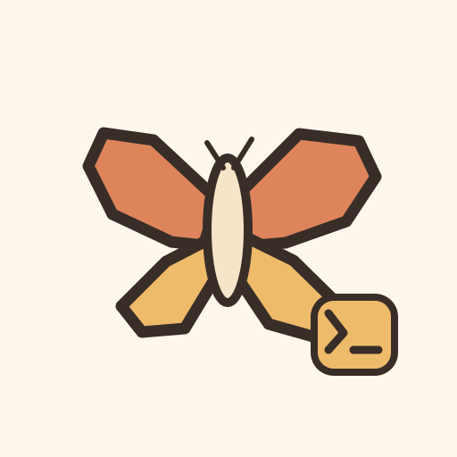

<div align="center">



🦋

# Bsky CLI


**A full Bluesky client for your terminal — post, thread, reply, browse, and manage, scriptable or interactive**

<a href="https://kud.io/projects/bsky-cli">Website</a> · <a href="https://kud.io/projects/bsky-cli/docs">Documentation</a>

</div>

## Features

- **Posting** — posts with an optional image and alt text, replies, quote-posts, language tags, and self-threads in one command
- **Engagement** — like, repost and follow, and their reversals
- **Reading** — home timeline, notifications, profiles, a post with its replies, and search
- **Your own posts** — list your recent posts with their links, delete one by URL or rkey
- **Interactive TUI** — run `bsky` on its own for a sidebar of Home, Notifications, Profile and New post, with keys to like, repost and reply from the feed

## Install

```sh
npm install -g @kud/bsky-cli
```

Binary: `bsky` · Requires Node.js >= 20

Sign in with a Bluesky **App Password** (Settings → App Passwords), through the two environment variables [`@kud/bsky`](https://github.com/kud/bsky) reads:

```sh
export BLUESKY_HANDLE=alice.example.com
export BLUESKY_APP_PASSWORD=<app-password>
```

## Usage

```console
$ bsky post "hello from the terminal" --image ./cat.png --alt "A cat on a keyboard"
✓ https://bsky.app/profile/alice.example.com/post/…

$ bsky thread "first post" "second post" "third post"
✓ Posted a 3-post thread

$ bsky reply <post-url> "agreed"
$ bsky quote <post-url> "worth a read"
$ bsky like <post-url>
$ bsky follow bob.example.com
$ bsky timeline --limit 10
$ bsky search "terminal" --limit 5
$ bsky delete <post-url-or-rkey>
$ bsky
```

| Command                                        | What it does                                                           |
| ---------------------------------------------- | ---------------------------------------------------------------------- |
| _(none)_                                       | Interactive TUI                                                        |
| `post <text>`                                  | Publish a post (`--image`, `--alt`, `--reply-to`, `--quote`, `--lang`) |
| `thread <post> <post> …`                       | Publish a self-thread, one argument per post                           |
| `reply <url> <text>`                           | Reply to a post                                                        |
| `quote <url> <text>`                           | Quote-post a post                                                      |
| `delete <url-or-rkey>`                         | Delete one of your posts                                               |
| `list`                                         | Your recent posts (`--limit`, default 25)                              |
| `like`, `unlike`, `repost`, `unrepost` `<url>` | Engage with a post                                                     |
| `follow`, `unfollow` `<handle>`                | Follow or unfollow an account                                          |
| `timeline`                                     | Your home timeline (`--limit`, default 25)                             |
| `notifications`                                | Your notifications (`--limit`, default 25)                             |
| `profile [handle]`                             | A profile, yours by default                                            |
| `view <url>`                                   | A post and its replies                                                 |
| `search <query>`                               | Search posts (`--limit`, default 25)                                   |

In the TUI: `↑↓` move, `←→` switch between the sidebar and the feed, `⏎` opens a post's thread (`esc` or `←` leaves it), `l` likes, `r` reposts, `c` replies, `q` quits. In the composer, `ctrl+d` or `shift+⏎` posts and `esc` cancels.

## Development

```sh
git clone https://github.com/kud/bsky-cli.git
cd bsky-cli
npm install
npm run dev
```

| Script              | Purpose                              |
| ------------------- | ------------------------------------ |
| `npm run build`     | Bundle to `dist/` with tsup          |
| `npm run dev`       | Run directly via tsx (no build step) |
| `npm run typecheck` | Type-check with `tsc --noEmit`       |

📚 **Full documentation → [bsky-cli/docs](https://kud.io/projects/bsky-cli/docs)**
